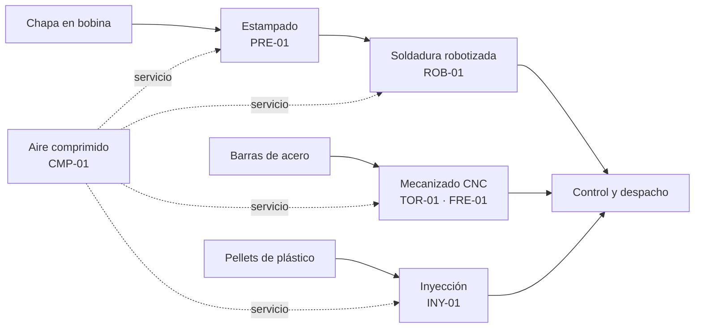

# Escenario: la planta y su gestión de mantenimiento

Define sobre qué empresa y qué proceso productivo trabaja el sistema GMAO del TP. Es el marco común de los datos simulados de la Fase III (`c_prototipado/sql/paso6-dml.sql`) y de las consultas de la Fase IV: todo lo que figura acá coincide con lo cargado en la base.

> **Empresa ficticia.** El nombre, la planta, el personal y los valores son inventados para el trabajo práctico. Las marcas y modelos de las máquinas son reales y se usan solo para que los datos sean verosímiles.

## 1. La empresa

| Campo | Valor |
|---|---|
| Nombre | **Autopartes G4 S.A.** (ficticia) |
| Rubro | Metalmecánica: proveedor de autopartes de segundo nivel (*Tier 2*) |
| Ubicación | Córdoba, Argentina |
| Productos | Soportes y refuerzos de chapa estampados y soldados, piezas mecanizadas (bujes, ejes, bridas) y componentes plásticos inyectados |
| Clientes | Proveedores de primer nivel (*Tier 1*) que abastecen a las terminales automotrices |
| Régimen de trabajo | Tres turnos: mañana, tarde y noche |

En la industria automotriz las entregas se programan con poco margen: una máquina parada demora el pedido del cliente. Por eso el mantenimiento es un área crítica y la planta necesita registrar las fallas, planificar el preventivo y controlar los repuestos. Ese es el problema que resuelve el GMAO.

## 2. Proceso productivo

1. **Estampado:** la prensa hidráulica corta y conforma la chapa en soportes y refuerzos.
2. **Soldadura:** el robot une las piezas estampadas en subconjuntos.
3. **Mecanizado:** el torno CNC y el centro de mecanizado fabrican piezas de precisión a partir de barras.
4. **Inyección:** la inyectora produce los componentes plásticos (tapas, clips, protectores).
5. **Servicios:** el compresor alimenta con aire comprimido a las herramientas neumáticas, los sujetadores y los actuadores de todas las líneas.

## 3. Activos bajo mantenimiento

Son las 6 máquinas de la tabla `maquinas`. La **criticidad** indica cuánto afecta su parada a la producción.

| Código | Máquina | Marca y modelo | Sector | Criticidad | Por qué |
|---|---|---|---|---|---|
| TOR-01 | Torno CNC | Haas ST-20 | Mecanizado | ALTA | Única máquina para bujes y ejes; sin respaldo en planta. |
| FRE-01 | Centro de mecanizado vertical | Haas VF-2 | Mecanizado | ALTA | Única máquina para bridas y piezas fresadas. |
| ROB-01 | Robot de soldadura | ABB IRB 2600 | Soldadura | ALTA | Sin él, los estampados no se pueden convertir en subconjuntos. |
| PRE-01 | Prensa hidráulica | Schuler PH 250 | Estampado | MEDIA | Se trabaja con stock intermedio de piezas estampadas, que da algunas horas de margen. |
| CMP-01 | Compresor de tornillo | Atlas Copco GA 37 | Servicios | MEDIA | Abastece a toda la planta, pero se alquila un compresor de respaldo ante una falla larga. |
| INY-01 | Inyectora de plástico | Engel e-mac 180 | Inyección | BAJA | Sus piezas tienen stock de seguridad y se pueden tercerizar. |

## 4. El área de mantenimiento

### Organización

Cinco técnicos de la tabla `tecnicos` cubren los tres turnos:

| Legajo | Técnico | Especialidad | Turno |
|---|---|---|---|
| L-1021 | Pérez, Juan | Mecánica | Mañana |
| L-1034 | González, María | Eléctrica | Mañana |
| L-1047 | Rodríguez, Carlos | Hidráulica | Tarde |
| L-1052 | Fernández, Lucía | Electrónica | Tarde |
| L-1068 | Martínez, Diego | Mecánica | Noche |

El **pañol de mantenimiento** guarda los repuestos (tabla `repuestos`) con su stock y su punto de reposición.

### Cómo trabaja

El área sigue el mismo esquema que los gestores de mantenimiento comerciales (ver `b_investigacion/gmao-sistemas-reales.md`):

- **Mantenimiento correctivo.** Cuando una máquina falla, el operador o el supervisor registra la falla con fecha, hora, descripción, severidad y horas de parada. El área emite una **orden de trabajo correctiva** y se la asigna a un técnico. Una misma orden puede atender varias fallas detectadas en la misma intervención. Mientras no se emite la orden, la falla queda pendiente.
- **Mantenimiento preventivo.** Para cada máquina hay **planes preventivos** con una tarea y su frecuencia, por calendario (cada N días) o por uso (cada N horas de horómetro). Cuando un plan vence, se emite una **orden de trabajo preventiva**. El preventivo no nace de una falla.
- **Ejecución y cierre.** Cada orden pasa por los estados *pendiente*, *en curso* y *cerrada*. Al cerrarla se registran las horas-hombre y los repuestos consumidos, que se descuentan del pañol.

### Planes preventivos vigentes

| Código | Máquina | Tarea | Frecuencia |
|---|---|---|---|
| PM-TOR01-LUB | TOR-01 | Lubricación de guías y control de nivel de aceite | Cada 30 días |
| PM-TOR01-COR | TOR-01 | Inspección y tensado de correas de transmisión | Cada 500 h |
| PM-FRE01-CON | FRE-01 | Limpieza y verificación del cono del husillo | Cada 250 h |
| PM-CMP01-ACE | CMP-01 | Cambio de aceite y filtro | Cada 2000 h |
| PM-ROB01-INS | ROB-01 | Inspección de cableado y respaldo de baterías del controlador | Cada 180 días |
| PM-PRE01-HID | PRE-01 | Control de presión y fugas del circuito hidráulico | Cada 90 días |

## 5. Qué necesita saber cada rol

Estas preguntas son las que responden las consultas de la Fase IV:

| Rol | Pregunta | Consulta |
|---|---|---|
| Supervisor de planta | ¿Qué fallas importantes hubo en un período? | 7.1 |
| Encargado del pañol | ¿Qué repuestos hay que reponer? | 7.2 |
| Supervisor de planta | ¿Qué correctivas siguen abiertas? | 7.3 |
| Jefe de mantenimiento | ¿Cuál es el activo más crítico por fallas y parada? | 8.1 |
| Jefe de mantenimiento | ¿Cuánto esfuerzo va a correctivo y cuánto a preventivo? | 8.2 |
| Operador / supervisor | Listado legible de órdenes con máquina, motivo y técnico | 9.1 |
| Jefe de mantenimiento | ¿Cuánto costaron los repuestos de cada intervención? | 9.2 |

## 6. Alcance del sistema

**Incluye:** registro de activos, historial de fallas, planes preventivos, órdenes de trabajo correctivas y preventivas, asignación de técnicos, consumo y stock de repuestos.

**No incluye:** compras y proveedores, costo de la mano de obra, programación automática del preventivo (las órdenes se emiten a mano cuando el plan vence), lecturas automáticas de sensores u horómetros, ni varias plantas.

## 7. Supuestos de los datos simulados

- Período registrado: del **2 de septiembre al 16 de octubre de 2026**.
- Fechas y horas en formato ISO 8601, en hora local de Córdoba.
- Costos de repuestos en **pesos argentinos**, como valores de referencia.
- Horas de parada y horas-hombre en horas decimales (1,5 = 1 h 30 min).
- Los teléfonos de los técnicos usan una numeración de ejemplo (`351-555-…`).
