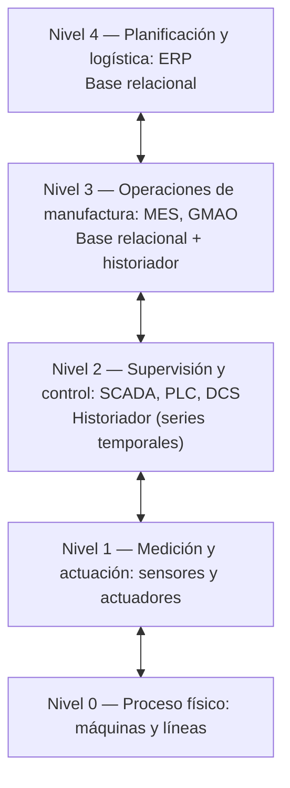
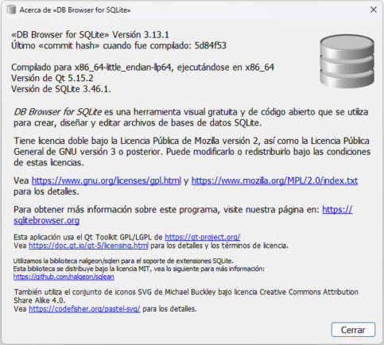
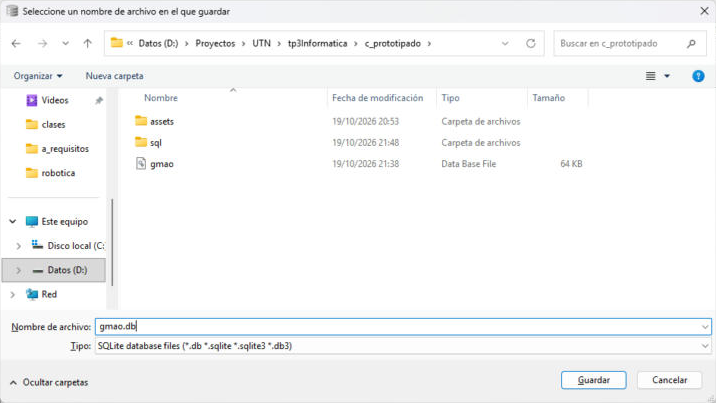
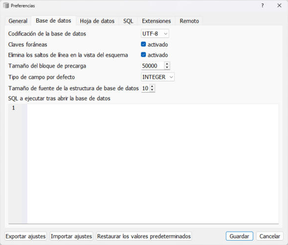
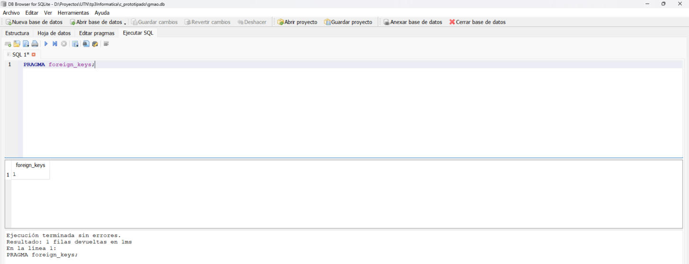

# Fase I — Fundamentos y clasificación (La Investigación)

En esta fase se investiga qué es una base de datos, cómo se clasifican y para qué se usan las bases relacionales en una planta industrial (Paso 1). Con esa base se elige y se justifica el gestor de base de datos del trabajo, se detallan sus requisitos de instalación y se describe cómo se accede a la base en forma local (Paso 2).

## Paso 1 — Definición y usos industriales de las bases de datos

### Qué es una base de datos

Una **base de datos** es un conjunto de datos relacionados entre sí, organizados con una estructura definida y guardados de forma permanente, para que distintas personas y programas puedan consultarlos y actualizarlos sin perder coherencia. La diferencia con un archivo suelto o una planilla es que la estructura y las reglas que deben cumplir los datos son parte de la propia base, y no dependen del cuidado de quien los carga.

El software que administra la base es el **sistema gestor de bases de datos** (SGBD, o DBMS en inglés). Es el que define la estructura, controla quién accede, hace cumplir las reglas de integridad y resuelve las consultas.

El modelo más difundido es el **relacional**, propuesto por E. F. Codd en 1970 [1]. En él los datos se organizan en **tablas**: cada fila es un registro y cada columna, un atributo. Las tablas se vinculan por medio de **claves**. La clave primaria (PK) identifica cada fila, y la clave foránea (FK) guarda la clave de otra tabla y crea el vínculo [2]. Para definir, cargar y consultar los datos se usa el lenguaje estándar **SQL** [2].

Las bases relacionales trabajan con **transacciones ACID**, que garantizan que los datos queden correctos aunque haya errores o cortes [2]:

- **Atomicidad:** una transacción se ejecuta completa o no se ejecuta.
- **Consistencia:** después de cada transacción los datos siguen cumpliendo todas las reglas definidas.
- **Aislamiento:** las transacciones simultáneas no se interfieren entre sí.
- **Durabilidad:** lo que se confirma queda guardado, aun ante un corte de energía.

### Clasificación de las bases de datos

Según cómo organizan los datos, las bases se agrupan en tres grandes familias, relevantes para la industria.

**Bases relacionales (SQL).** Tienen un esquema fijo, definido antes de cargar los datos, y vinculan las tablas por claves. Ofrecen consistencia fuerte (ACID) y permiten cruzar información de varias tablas en una sola consulta (`JOIN`). Crecen principalmente en forma **vertical**, con un servidor más potente [3]. Ejemplos: SQLite, PostgreSQL, MySQL, SQL Server y Oracle.

**Bases NoSQL** (*not only SQL*). Guardan los datos fuera del modelo de tablas, en general sin un esquema fijo, y suelen estar distribuidas en varios servidores, por lo que crecen en forma **horizontal** [3]. Hay cuatro tipos principales [3]:

- **documentales**, que guardan documentos JSON (por ejemplo, MongoDB);
- **clave-valor**, usadas como memoria caché (por ejemplo, Redis);
- **de columnas amplias**, para grandes volúmenes de datos dispersos (por ejemplo, Cassandra);
- **de grafos**, para redes de relaciones (por ejemplo, Neo4j).

Su punto débil son las transacciones complejas y las relaciones entre entidades, que son más difíciles de garantizar que en una base relacional [3].

**Bases de series temporales (TSDB).** Están diseñadas para mediciones con marca de tiempo que llegan en forma continua, como las de sensores. Admiten un volumen de escritura muy alto y resuelven rápido las consultas por rangos de tiempo. A cambio, modificar o borrar un dato puntual es lento, algo que en este tipo de datos casi no ocurre [4]. Incluyen políticas de retención y comprimen mucho los datos [4]. Los **historiadores de proceso** de los sistemas SCADA son una forma de base de series temporales [5]. Ejemplos: InfluxDB, TimescaleDB y los historiadores industriales.

| Criterio | Relacional | NoSQL | Series temporales |
|---|---|---|---|
| Modelo | Tablas vinculadas por claves | Documentos, clave-valor, columnas o grafos | Mediciones con marca de tiempo |
| Esquema | Fijo, definido de antemano | Flexible o sin esquema | Flexible, centrado en el tiempo |
| Consistencia | Fuerte (ACID) | Variable según el motor | Orientada a la escritura masiva |
| Crecimiento | Vertical | Horizontal | Horizontal, con compresión |
| Consulta típica | Cruces entre tablas y reportes | Lectura por clave o documento | Rangos de tiempo, promedios y tendencias |
| Uso en planta | ERP, MES, GMAO, recetas, calidad | Configuraciones, registros de eventos, datos heterogéneos | Variables de proceso, sensores, historiador SCADA |

En una fábrica estas familias no compiten: se **complementan**. Lo habitual es una arquitectura híbrida, con una base relacional para las entidades de gestión (órdenes, equipos, materiales, personal) y una base de series temporales para las mediciones de alta frecuencia [4].

### Tres usos críticos de las bases relacionales en la fábrica

El estándar **ISA-95** (IEC 62264) organiza la empresa industrial en cinco niveles, desde el proceso físico hasta la gestión del negocio [6]. Sirve para ubicar dónde se usa cada tipo de base de datos:



Los niveles 3 y 4, donde se gestionan órdenes, equipos, materiales y personas, son el terreno de las bases relacionales. Tres usos críticos son los siguientes.

#### Uso 1 — Integración entre el ERP y el MES

El ERP (nivel 4) planifica qué se produce, y el MES (nivel 3) gestiona cómo se produce en planta. ISA-95 define el intercambio entre esos dos niveles y los modelos de datos de equipos, materiales, personal y órdenes que comparten, que son la base para diseñar bases relacionales [6][7]. La base relacional guarda las órdenes de producción que bajan del ERP, la producción real y los consumos que suben del MES, y los maestros de materiales y equipos.

Es un uso crítico porque cada dato tiene que ser coherente con los demás: una orden no puede hacer referencia a un material inexistente, y un consumo no puede registrarse a medias. La integridad referencial y las transacciones ACID garantizan las dos cosas. Además, el nivel 3 actúa como capa intermedia: el ERP es un sistema transaccional y no está pensado para recibir datos de sensores en tiempo real [7].

#### Uso 2 — Almacenamiento y versionado de recetas de proceso

En los procesos por lotes (alimentos, química, farmacia), el estándar **ISA-88** define las recetas en cuatro niveles: general, de sitio, maestra y de control. Cada receta tiene un encabezado, una fórmula con parámetros y materiales, los requerimientos de equipo y el procedimiento [8]. La **receta maestra** es la aprobada para un conjunto de equipos, y la **receta de control** es la copia que se ejecuta en un lote concreto, con sus valores reales [8].

Una receta es información estructurada y relacionada: pasos, parámetros, consignas y materiales. Guardarla en una base relacional permite controlar sus versiones y su estado de aprobación, impedir que se ejecute una receta no aprobada y registrar qué versión se usó en cada lote, lo que da trazabilidad ante un reclamo de calidad.

#### Uso 3 — Gestión del mantenimiento (GMAO)

Un sistema de **gestión de mantenimiento asistido por ordenador** (GMAO, o CMMS en inglés) centraliza la información de mantenimiento de la planta [9]:

- el registro de activos y su historial de intervenciones;
- las órdenes de trabajo, desde que se emiten hasta que se cierran, con el técnico asignado;
- los planes de mantenimiento preventivo, que se disparan por tiempo o por uso;
- el stock de repuestos y su reposición cuando baja del mínimo.

Son entidades bien definidas y muy relacionadas: una máquina tiene fallas, las fallas generan órdenes de trabajo, las órdenes se asignan a técnicos y consumen repuestos. Los reportes que necesita el área de mantenimiento cruzan esas tablas y calculan indicadores, como las fallas por máquina, el tiempo de parada o las horas-hombre. Ese es exactamente el tipo de problema que resuelve una base relacional, y es el **escenario elegido para este trabajo**, que se desarrolla en las Fases II a IV.

## Paso 2 — Selección del motor de base de datos y requerimientos

### Elección del gestor: SQLite

Para el trabajo se eligió **SQLite**. Sus características, según la documentación oficial, son las siguientes [10]:

- **Sin servidor:** es una biblioteca que corre dentro del programa que la usa y lee y escribe directamente sobre un archivo. No hay un servicio que instalar, configurar ni administrar.
- **Un solo archivo:** la base completa, con tablas, índices y *triggers*, queda en un único archivo `.db`, fácil de copiar y de entregar.
- **Transacciones ACID**, aun ante caídas del sistema o cortes de energía.
- **Claves foráneas, restricciones `CHECK` y *triggers***, que son las herramientas de integridad que necesita el modelo GMAO [15].
- **Dominio público:** se puede usar libremente con cualquier fin.
- **Multiplataforma y liviano:** el mismo archivo funciona en Windows, Linux y macOS, y la biblioteca completa ocupa menos de 900 KiB.

El propio proyecto SQLite lo recomienda para dispositivos embebidos, para análisis de datos y para **educación**, porque se instala en forma trivial y las bases se crean y se comparten con facilidad [11]. Es el caso de este trabajo práctico.

También tiene límites, que hay que conocer [11]. Admite **un solo escritor a la vez**, no conviene usarlo a través de una red y, para volúmenes del orden de los terabytes, es preferible un motor cliente-servidor. Por eso, un GMAO multiusuario en una planta real correría sobre PostgreSQL, SQL Server o MySQL. Para diseñar, construir y probar el modelo, SQLite alcanza, y el SQL usado es estándar y se puede trasladar a esos motores.

| Criterio | SQLite | Cliente-servidor (PostgreSQL, MySQL, SQL Server) |
|---|---|---|
| Arquitectura | Biblioteca embebida, archivo local | Servicio en un servidor, acceso por red |
| Instalación | Nula: el motor viene incluido en la herramienta | Instalar y configurar un servicio, usuarios y permisos |
| Escritura simultánea | Un escritor a la vez | Muchos escritores simultáneos |
| Entrega del trabajo | Un archivo `.db` | Exportar un volcado de la base |
| Uso típico | Embebido, IoT, educación, prototipos | Sistemas de planta multiusuario |

### Herramienta de gestión: DB Browser for SQLite

Como interfaz gráfica se usa **DB Browser for SQLite**, una herramienta visual de código abierto para crear, editar y consultar bases SQLite [12]. Las licencias publicadas en su repositorio son GPL-3.0 y MPL-2.0 [13]. Funciona en Windows, macOS y Linux [12]. Para este trabajo aporta [12]:

- la creación de la base y la ejecución de scripts SQL completos, con su panel de mensajes (Pasos 5 a 9);
- la vista de la estructura de la base, con tablas, columnas y *triggers* (Pasos 4 y 5);
- la navegación de los registros de cada tabla (Paso 6);
- la exportación de la base como script SQL, útil para el respaldo.

### Requerimientos de instalación

La versión estable de DB Browser for SQLite es la **3.13.1** [13][14]. Para Windows se ofrece como instalador `.msi` y como `.zip` sin instalación, en versiones de 32 bits, 64 bits y ARM64, además de una versión portable; los ejecutables están firmados digitalmente [14]. También se puede instalar con gestores de paquetes como `winget` [13]. **No hace falta instalar SQLite por separado**, porque la herramienta trae el motor incluido. El sitio oficial no publica requisitos mínimos de hardware [14], de modo que se documentan los del equipo donde se hizo el trabajo:

| Elemento | Valor |
|---|---|
| Sistema operativo | Windows 11 Pro, 64 bits (versión 10.0.26200) |
| Procesador | AMD Ryzen 5 5500 |
| Memoria RAM | 16 GB |
| DB Browser for SQLite | 3.13.1, instalador `.msi` de 64 bits |
| Motor SQLite incluido | 3.46.1 |
| Espacio ocupado por la instalación | 47 MB |
| Carpeta de instalación | `C:\Program Files\DB Browser for SQLite\` |

La instalación se hizo con el gestor de paquetes de Windows:

```text
winget install --id DBBrowserForSQLite.DBBrowserForSQLite -e
```



### Método de acceso local

Como SQLite no tiene servidor, acceder a la base es abrir su archivo. El procedimiento en DB Browser for SQLite es el siguiente:

1. Abrir DB Browser for SQLite y elegir **Nueva base de datos**. Indicar la carpeta y el nombre del archivo: `gmao.db`. Si se abre el asistente para crear una tabla, cerrarlo, porque las tablas se crean por código en el Paso 5.
2. En **Editar → Preferencias → Base de datos**, verificar que esté activada la opción de **claves foráneas**. En SQLite la verificación de claves foráneas viene desactivada por defecto y se activa en cada conexión con `PRAGMA foreign_keys = ON` [15]. Los scripts del trabajo incluyen esa sentencia al comienzo, para no depender de la configuración.
3. En la pestaña **Ejecutar SQL**, escribir o abrir un script y ejecutarlo con **Ejecutar todo** (`F5`). El panel inferior informa si la ejecución terminó sin errores.
4. Confirmar los cambios con **Guardar cambios** (`Ctrl+S`). Hasta ese momento los cambios quedan en una transacción abierta y se pierden si se cierra el programa.
5. Revisar el resultado en las pestañas **Estructura** (tablas, columnas y *triggers*) y **Hoja de datos** (registros de cada tabla).
6. Para volver a trabajar, abrir el mismo archivo con **Abrir base de datos**.

Para comprobar que las claves foráneas están activas, se ejecuta:

```sql
PRAGMA foreign_keys;
```

El resultado `1` indica que están activadas, y `0`, que no.




