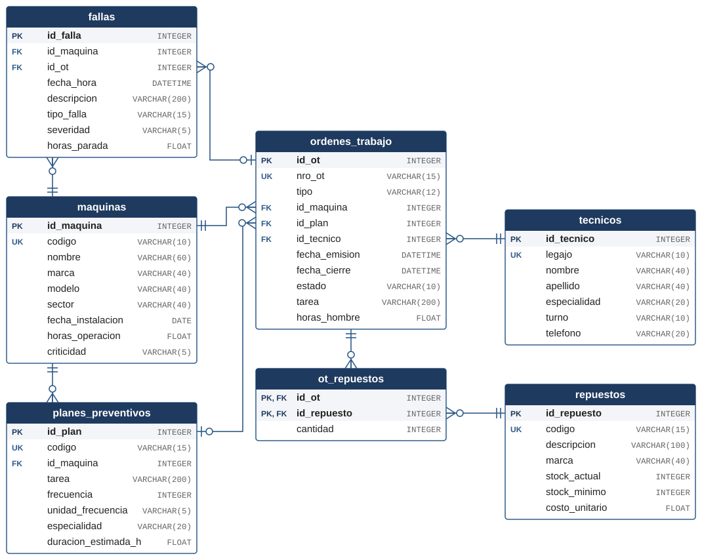

# Fase II — Diseño conceptual y modelado (La Planificación)

En esta fase se traduce el escenario de Gestión de Mantenimiento Industrial (GMAO) a un modelo de datos. Primero se identifican las entidades del proceso de mantenimiento y sus atributos, con el tipo de dato adecuado para cada uno (Paso 3). Después se arma el modelo relacional con sus claves primarias, claves foráneas y cardinalidades (Paso 4). El resultado de esta fase es la base de los scripts de la Fase III.

## Paso 3 — Identificación de entidades y atributos

### Justificación teórica

Una **entidad** es un objeto del mundo real del que interesa guardar información y que se distingue de los demás: una máquina, un técnico, una falla. Cada entidad se describe con **atributos**, y cada atributo toma valores de un **dominio**, que en la base de datos se expresa con un **tipo de dato**. Elegir bien el tipo de dato no es un detalle: define qué valores se aceptan, cuánto espacio ocupan, cómo se ordenan y qué operaciones se pueden hacer con ellos. Una variable analógica guardada como texto, por ejemplo, no se puede promediar.

### Tipos de datos en SQLite

En SQLite el tipado es dinámico: el tipo pertenece al valor y no a la columna. Cada columna tiene una **afinidad** que se deduce del tipo declarado y que indica la clase de almacenamiento preferida (`INTEGER`, `REAL`, `TEXT`, `BLOB` o `NUMERIC`). Por eso se pueden declarar los tipos industriales habituales (`INT`, `VARCHAR`, `FLOAT`, `DATETIME`) y SQLite los acepta y los asigna a su afinidad:

| Tipo declarado | Afinidad en SQLite | Uso en este modelo |
|---|---|---|
| `INTEGER` | INTEGER | Identificadores y cantidades enteras (stock, unidades consumidas, frecuencias). |
| `VARCHAR(n)` | TEXT | Nombres, códigos, descripciones y estados. SQLite no limita el largo `n`, pero se declara para documentar el tamaño esperado. |
| `FLOAT` | REAL | Variables analógicas y continuas: horas de operación, horas de parada, horas-hombre, costos. |
| `DATE` | NUMERIC | Fechas sin hora (instalación de un equipo). |
| `DATETIME` | NUMERIC | Marcas de tiempo de eventos (falla, emisión y cierre de una orden). |

SQLite no tiene un tipo propio para fechas. Se adopta el formato de texto **ISO 8601** (`AAAA-MM-DD HH:MM:SS`), que se ordena correctamente como texto, se compara con `BETWEEN` y se puede procesar con las funciones de fecha de SQLite.

Los identificadores se declaran `INTEGER PRIMARY KEY`. En SQLite esa combinación convierte la columna en alias del identificador interno de cada fila (`rowid`), lo que la hace única, no nula y autoincremental sin configuración adicional.

### Procedimiento

Para definir las entidades se relevó cómo resuelven el mantenimiento los gestores de uso industrial, en particular SAP PM, Odoo Maintenance e IBM Maximo. Los tres coinciden en que el mantenimiento **correctivo** y el **preventivo** tienen orígenes distintos y terminan en el mismo documento de ejecución, la orden de trabajo:

1. **Correctivo.** Una **máquina** (activo) presenta una **falla**, que se registra con su fecha, hora, descripción y tiempo de parada. A partir de la falla se emite una **orden de trabajo** correctiva. Mientras no se emite la orden, la falla queda pendiente. Una misma orden puede atender varias fallas detectadas en la misma intervención, como en el esquema aviso–orden de SAP PM.
2. **Preventivo.** El área de mantenimiento preventivo define, para cada máquina, **planes preventivos**: una tarea con su frecuencia, por calendario (cada N días) o por uso (cada N horas de operación del horómetro). Cuando el plan vence, se emite una **orden de trabajo** preventiva. En el preventivo **no existe falla**: la orden nace del plan.
3. En los dos casos la orden se asigna a un **técnico** responsable y registra fechas, estado y horas-hombre.
4. Durante el trabajo se consumen **repuestos** del almacén, y una misma orden puede usar varios repuestos distintos.

De ese recorrido surgen seis entidades: las cinco que nombra el enunciado para GMAO (activos, fallas, órdenes de trabajo, técnicos y repuestos) más los **planes preventivos**, que son el origen de las órdenes preventivas. Una séptima tabla, `ot_repuestos`, registra qué repuestos y en qué cantidad se consumieron en cada orden: una orden usa varios repuestos y un repuesto se usa en varias órdenes, y esa relación de muchos a muchos se resuelve en el Paso 4.

Para cada atributo se definió el tipo de dato y las restricciones que se aplicarán en el Paso 5: clave primaria (PK), clave foránea (FK), obligatorio (`NOT NULL`), único (`UNIQUE`) o con valores permitidos (`CHECK`).

### Estructura de la tabla `maquinas`

| Campo | Tipo | Restricciones | Descripción |
|---|---|---|---|
| `id_maquina` | `INTEGER` | PK | Identificador interno. |
| `codigo` | `VARCHAR(10)` | `NOT NULL`, `UNIQUE` | Código o TAG del activo en planta (p. ej. `TOR-01`). |
| `nombre` | `VARCHAR(60)` | `NOT NULL` | Nombre descriptivo del equipo. |
| `marca` | `VARCHAR(40)` | — | Fabricante. |
| `modelo` | `VARCHAR(40)` | — | Modelo del fabricante. |
| `sector` | `VARCHAR(40)` | `NOT NULL` | Sector o línea donde está instalado. |
| `fecha_instalacion` | `DATE` | — | Fecha de puesta en servicio. |
| `horas_operacion` | `FLOAT` | — | Horómetro acumulado, en horas. |
| `criticidad` | `VARCHAR(5)` | `NOT NULL`, `CHECK` (`ALTA`, `MEDIA`, `BAJA`) | Impacto de su parada en la producción. |

Registro de activos de la planta: cada equipo sujeto a mantenimiento.

### Estructura de la tabla `tecnicos`

| Campo | Tipo | Restricciones | Descripción |
|---|---|---|---|
| `id_tecnico` | `INTEGER` | PK | Identificador interno. |
| `legajo` | `VARCHAR(10)` | `NOT NULL`, `UNIQUE` | Número de legajo del empleado. |
| `nombre` | `VARCHAR(40)` | `NOT NULL` | Nombre. |
| `apellido` | `VARCHAR(40)` | `NOT NULL` | Apellido. |
| `especialidad` | `VARCHAR(20)` | `NOT NULL` | Mecánica, eléctrica, hidráulica, electrónica. |
| `turno` | `VARCHAR(10)` | `NOT NULL`, `CHECK` (`MAÑANA`, `TARDE`, `NOCHE`) | Turno de trabajo. |
| `telefono` | `VARCHAR(20)` | — | Teléfono interno o celular de guardia. |

Personal de mantenimiento al que se asignan las órdenes.

### Estructura de la tabla `planes_preventivos`

| Campo | Tipo | Restricciones | Descripción |
|---|---|---|---|
| `id_plan` | `INTEGER` | PK | Identificador interno. |
| `codigo` | `VARCHAR(15)` | `NOT NULL`, `UNIQUE` | Código del plan (p. ej. `PM-CMP01-ACE`). |
| `id_maquina` | `INTEGER` | FK → `maquinas`, `NOT NULL` | Equipo al que se aplica el plan. |
| `tarea` | `VARCHAR(200)` | `NOT NULL` | Rutina a ejecutar (p. ej. cambio de aceite y filtro). |
| `frecuencia` | `INTEGER` | `NOT NULL`, `CHECK` (> 0) | Cada cuánto se repite la tarea. |
| `unidad_frecuencia` | `VARCHAR(5)` | `NOT NULL`, `CHECK` (`DIAS`, `HORAS`) | Por calendario (días) o por uso (horas de operación). |
| `especialidad` | `VARCHAR(20)` | `NOT NULL` | Especialidad del técnico que la ejecuta. |
| `duracion_estimada_h` | `FLOAT` | — | Duración prevista de la tarea, en horas. |

Rutinas del área de mantenimiento preventivo: cada una da origen a órdenes preventivas periódicas.

### Estructura de la tabla `ordenes_trabajo`

| Campo | Tipo | Restricciones | Descripción |
|---|---|---|---|
| `id_ot` | `INTEGER` | PK | Identificador interno. |
| `nro_ot` | `VARCHAR(15)` | `NOT NULL`, `UNIQUE` | Número de orden visible en planta (p. ej. `OT-2026-0101`). |
| `tipo` | `VARCHAR(12)` | `NOT NULL`, `CHECK` (`CORRECTIVA`, `PREVENTIVA`) | Tipo de mantenimiento. |
| `id_maquina` | `INTEGER` | FK → `maquinas`, `NOT NULL` | Equipo intervenido. |
| `id_plan` | `INTEGER` | FK → `planes_preventivos` | Plan que originó la orden. Obligatorio en las preventivas y vacío (`NULL`) en las correctivas. |
| `id_tecnico` | `INTEGER` | FK → `tecnicos`, `NOT NULL` | Técnico asignado. |
| `fecha_emision` | `DATETIME` | `NOT NULL` | Fecha y hora de emisión. |
| `fecha_cierre` | `DATETIME` | — | Fecha y hora de cierre. Vacío mientras la orden sigue abierta. |
| `estado` | `VARCHAR(10)` | `NOT NULL`, `CHECK` (`PENDIENTE`, `EN CURSO`, `CERRADA`) | Estado de la orden. |
| `tarea` | `VARCHAR(200)` | `NOT NULL` | Trabajo a realizar o realizado. |
| `horas_hombre` | `FLOAT` | — | Horas-hombre insumidas. |

Órdenes de trabajo (OT) correctivas y preventivas. Un `CHECK` de tabla exige que el origen corresponda al tipo: `(tipo = 'PREVENTIVA' AND id_plan IS NOT NULL) OR (tipo = 'CORRECTIVA' AND id_plan IS NULL)`.

### Estructura de la tabla `fallas`

| Campo | Tipo | Restricciones | Descripción |
|---|---|---|---|
| `id_falla` | `INTEGER` | PK | Identificador interno. |
| `id_maquina` | `INTEGER` | FK → `maquinas`, `NOT NULL` | Equipo que falló. |
| `id_ot` | `INTEGER` | FK → `ordenes_trabajo` | Orden correctiva que la atiende. Vacío (`NULL`) mientras la falla está pendiente. |
| `fecha_hora` | `DATETIME` | `NOT NULL` | Marca de tiempo del evento (ISO 8601). |
| `descripcion` | `VARCHAR(200)` | `NOT NULL` | Descripción del síntoma o del daño. |
| `tipo_falla` | `VARCHAR(15)` | `NOT NULL` | Mecánica, eléctrica, hidráulica, neumática, electrónica. |
| `severidad` | `VARCHAR(5)` | `NOT NULL`, `CHECK` (`ALTA`, `MEDIA`, `BAJA`) | Gravedad de la falla. |
| `horas_parada` | `FLOAT` | — | Tiempo que el equipo estuvo detenido, en horas. |

Historial de fallas: cada evento que dejó un equipo fuera de servicio o fuera de condición. Con `fecha_hora` y `horas_parada` se pueden calcular indicadores de mantenimiento como el tiempo medio de reparación (MTTR).

### Estructura de la tabla `repuestos`

| Campo | Tipo | Restricciones | Descripción |
|---|---|---|---|
| `id_repuesto` | `INTEGER` | PK | Identificador interno. |
| `codigo` | `VARCHAR(15)` | `NOT NULL`, `UNIQUE` | Código de almacén o del fabricante. |
| `descripcion` | `VARCHAR(100)` | `NOT NULL` | Descripción del repuesto. |
| `marca` | `VARCHAR(40)` | — | Fabricante. |
| `stock_actual` | `INTEGER` | `NOT NULL` | Unidades disponibles. |
| `stock_minimo` | `INTEGER` | `NOT NULL` | Punto de reposición: por debajo de este valor el stock es crítico. |
| `costo_unitario` | `FLOAT` | — | Costo por unidad, en pesos. |

Catálogo y stock de repuestos del almacén de mantenimiento.

### Estructura de la tabla `ot_repuestos`

| Campo | Tipo | Restricciones | Descripción |
|---|---|---|---|
| `id_ot` | `INTEGER` | PK, FK → `ordenes_trabajo` | Orden en la que se consumió. |
| `id_repuesto` | `INTEGER` | PK, FK → `repuestos` | Repuesto consumido. |
| `cantidad` | `INTEGER` | `NOT NULL`, `CHECK` (> 0) | Unidades consumidas. |

Consumo de repuestos por orden de trabajo (tabla intermedia). Su clave primaria es **compuesta** (`id_ot`, `id_repuesto`): un mismo repuesto se registra una sola vez por orden, con la cantidad total consumida.

## Paso 4 — Construcción del modelo relacional

### Justificación teórica

El **modelo relacional** representa los datos como un conjunto de tablas (relaciones) vinculadas entre sí por sus claves:

- La **clave primaria (PK)** identifica de forma única cada fila de una tabla. No puede repetirse ni quedar vacía.
- La **clave foránea (FK)** es una columna que guarda el valor de la PK de otra tabla y crea el vínculo entre ambas. La **integridad referencial** garantiza que toda FK apunte a una fila que existe: no puede haber una falla de una máquina que no está registrada. Una FK que admite `NULL` representa una relación **opcional**; SQLite solo verifica la referencia cuando la FK tiene un valor.
- La **cardinalidad** indica cuántas filas de una tabla se relacionan con cuántas de la otra: uno a uno (1:1), uno a muchos (1:N) o muchos a muchos (N:M). En una relación 1:N la FK va en la tabla del lado "muchos". Las relaciones N:M no se pueden representar directamente con una FK y se resuelven con una **tabla intermedia** cuya PK combina las claves de ambas tablas.

El diseño se ajusta a la **tercera forma normal (3FN)**: cada atributo depende solo de la clave de su tabla. Por ejemplo, el nombre de la máquina se guarda una sola vez en `maquinas`, y las demás tablas la referencian por `id_maquina`. Así se evitan datos repetidos y las inconsistencias que aparecen al modificarlos en un lugar y no en otro.

### Procedimiento

1. Se identificaron las relaciones entre las entidades del Paso 3 a partir de las reglas del proceso de mantenimiento.
2. Para cada relación 1:N se colocó la FK en la tabla del lado "muchos".
3. La relación N:M entre órdenes de trabajo y repuestos se resolvió con la tabla intermedia `ot_repuestos`.
4. Se definieron las reglas que relacionan el tipo de orden con su origen y se decidió cómo hacerlas cumplir en la base.
5. Se dibujó el diagrama entidad-relación (DER) con las PK, FK y cardinalidades.
6. Se verificó el modelo en SQLite con un prototipo: se crearon las tablas, se cargaron casos válidos (que la base acepta) y casos inválidos (que la base debe rechazar), y se comprobó que cada regla se cumple.

### Relaciones del modelo

| Relación | Cardinalidad | Implementación | Regla del proceso |
|---|---|---|---|
| `maquinas` → `fallas` | 1:N | FK `fallas.id_maquina` | Una máquina acumula muchas fallas; cada falla pertenece a una sola máquina. |
| `maquinas` → `planes_preventivos` | 1:N | FK `planes_preventivos.id_maquina` | Una máquina tiene varios planes (aceite, correas, inspecciones); cada plan es de una máquina. |
| `maquinas` → `ordenes_trabajo` | 1:N | FK `ordenes_trabajo.id_maquina` | Una máquina recibe muchas OT, correctivas y preventivas. |
| `ordenes_trabajo` → `fallas` | 1:N (opcional) | FK `fallas.id_ot`, admite `NULL` | Una OT correctiva atiende una o más fallas; una falla sin OT está pendiente. |
| `planes_preventivos` → `ordenes_trabajo` | 1:N (opcional) | FK `ordenes_trabajo.id_plan`, admite `NULL` | Cada vencimiento del plan genera una OT preventiva; las correctivas no tienen plan. |
| `tecnicos` → `ordenes_trabajo` | 1:N | FK `ordenes_trabajo.id_tecnico` | Un técnico tiene muchas OT asignadas; cada OT tiene un técnico responsable. |
| `ordenes_trabajo` ↔ `repuestos` | N:M | Tabla `ot_repuestos` | Una OT consume varios repuestos; un repuesto se usa en muchas OT. |

### Diagrama entidad-relación

El diagrama usa la notación de «pata de gallo»: la doble barra indica «exactamente uno», la barra con círculo «cero o uno» y la pata de gallo con círculo «cero o muchos». Las relaciones de `fallas` y de `planes_preventivos` con `ordenes_trabajo` son opcionales: una falla puede estar pendiente, sin orden, y una orden correctiva no tiene plan. Las filas sombreadas son las claves primarias; `UK` marca los campos únicos (códigos, legajo y número de orden).

### Reglas de integridad del proceso

El origen de una orden depende de su tipo. Estas reglas se hacen cumplir en la propia base, para que no dependan del cuidado de quien carga los datos:

| Regla | Cómo se hace cumplir |
|---|---|
| Una OT preventiva tiene plan; una correctiva no. | `CHECK` en `ordenes_trabajo`. |
| Una OT preventiva es de la misma máquina que su plan. | *Trigger* sobre `ordenes_trabajo`. |
| Una falla solo se asigna a una OT **correctiva** de la **misma máquina**. | *Trigger* sobre `fallas`. |

Un `CHECK` solo puede comparar columnas de la misma fila. Las dos últimas reglas necesitan consultar otra tabla, y para eso SQLite ofrece los *triggers*: sentencias que se ejecutan automáticamente antes de una inserción o modificación y que pueden cancelarla con un mensaje de error. Se implementan en el Paso 5.

La orden de trabajo guarda `id_maquina` aunque la máquina también podría deducirse de su falla o de su plan. Es una redundancia controlada: permite listar las órdenes con su máquina mediante un vínculo directo, y su coherencia queda garantizada por las reglas anteriores.
