# Fase III — Implementación y carga de datos mediante SQL (La Construcción)

En esta fase el modelo de la Fase II se convierte en una base de datos real. Primero se escriben las sentencias de creación de tablas, con todas sus restricciones de integridad (Paso 5), y después se cargan datos simulados de planta (Paso 6). Los dos scripts se ejecutaron en DB Browser for SQLite sobre una base vacía, en ese orden, y se verificó que la base acepta los datos válidos y rechaza los inválidos.

## Paso 5 — Scripts de creación de tablas (DDL)

### Justificación teórica

SQL se divide en sublenguajes según su función. El **DDL** (*Data Definition Language*, lenguaje de definición de datos) crea, modifica y elimina la estructura de la base: tablas, índices y *triggers*. Su sentencia principal es `CREATE TABLE`, que define el nombre de la tabla, sus columnas con el tipo de dato y las **restricciones de integridad** que todo registro debe cumplir:

| Restricción | Qué garantiza | Ejemplo en el modelo |
|---|---|---|
| `PRIMARY KEY` | Cada fila se identifica de forma única y su clave no puede quedar vacía. | `id_maquina INTEGER PRIMARY KEY` |
| `FOREIGN KEY … REFERENCES` | El valor existe en la tabla referenciada (integridad referencial). | `FOREIGN KEY (id_maquina) REFERENCES maquinas (id_maquina)` |
| `NOT NULL` | El campo es obligatorio. | `nombre VARCHAR(60) NOT NULL` |
| `UNIQUE` | No se repite el valor en toda la tabla. | `codigo VARCHAR(10) NOT NULL UNIQUE` |
| `CHECK` | El valor cumple una condición. | `CHECK (estado IN ('PENDIENTE', 'EN CURSO', 'CERRADA'))` |

Un `CHECK` solo puede evaluar columnas de la misma fila. Las reglas que necesitan consultar otra tabla, como que una falla se asigne solo a una orden correctiva de la misma máquina, se implementan con **triggers**: bloques que SQLite ejecuta automáticamente antes de una inserción o una modificación y que, si la regla no se cumple, cancelan la operación con `RAISE(ABORT, 'mensaje')`.

En SQLite la verificación de claves foráneas viene **desactivada por defecto** y se activa en cada conexión con `PRAGMA foreign_keys = ON`. Por eso el script empieza con esa sentencia. A continuación borra las tablas si ya existían (`DROP TABLE IF EXISTS`), de modo que se puede volver a ejecutar desde cero. El borrado se hace en orden inverso a las dependencias: primero las tablas que referencian a otras.

Las tablas se crean en el orden contrario, empezando por las que no dependen de ninguna: `maquinas`, `tecnicos` y `repuestos`; después `planes_preventivos`, `ordenes_trabajo` y `fallas`; y al final la tabla intermedia `ot_repuestos`.

### Procedimiento

1. En DB Browser for SQLite se eligió **Nueva base de datos** y se guardó el archivo `gmao.db`. El asistente de creación de tablas se cerró sin usarlo, porque las tablas se crean por código.
2. En **Editar → Preferencias → Base de datos** se verificó que la opción de claves foráneas estuviera activada. De todas formas, el script incluye el `PRAGMA`.
3. En la pestaña **Ejecutar SQL** se cargó el script `paso5-ddl.sql` y se ejecutó completo con **Ejecutar todo** (`F5`).
4. Se revisó el panel de mensajes: la ejecución terminó sin errores.
5. Se confirmaron los cambios con **Guardar cambios** (`Ctrl+S`).
6. En la pestaña **Estructura** se comprobaron las 7 tablas, sus columnas y los 4 *triggers*.

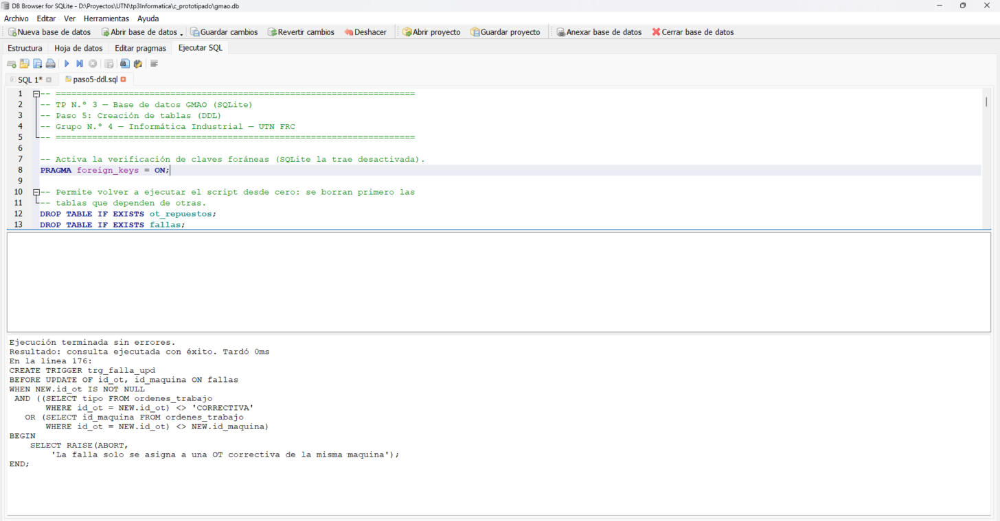
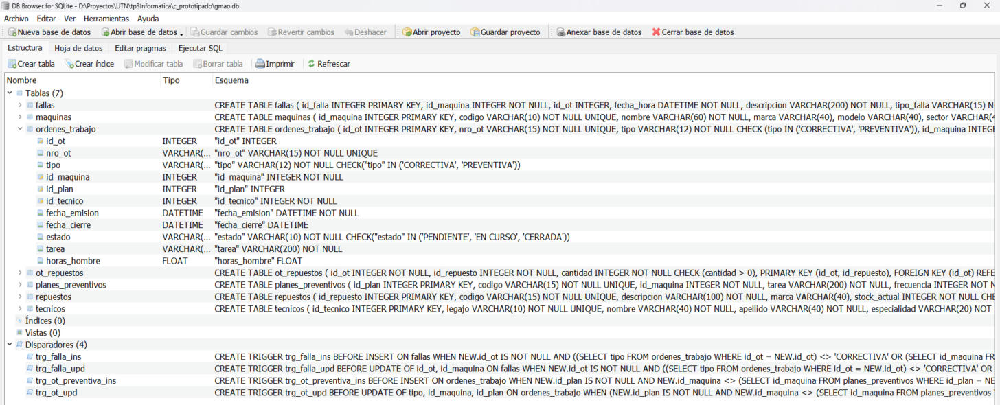

### Activación de claves foráneas y reinicio de la base

```sql
-- =====================================================================
-- TP N.º 3 — Base de datos GMAO (SQLite)
-- Paso 5: Creación de tablas (DDL)
-- Grupo N.º 4 — Informática Industrial — UTN FRC
-- =====================================================================

-- Activa la verificación de claves foráneas (SQLite la trae desactivada).
PRAGMA foreign_keys = ON;

-- Permite volver a ejecutar el script desde cero: se borran primero las
-- tablas que dependen de otras.
DROP TABLE IF EXISTS ot_repuestos;
DROP TABLE IF EXISTS fallas;
DROP TABLE IF EXISTS ordenes_trabajo;
DROP TABLE IF EXISTS planes_preventivos;
DROP TABLE IF EXISTS repuestos;
DROP TABLE IF EXISTS tecnicos;
DROP TABLE IF EXISTS maquinas;
```

### Tabla `maquinas`

```sql
-- ---------------------------------------------------------------------
-- Activos de la planta
-- ---------------------------------------------------------------------
CREATE TABLE maquinas (
    id_maquina        INTEGER      PRIMARY KEY,
    codigo            VARCHAR(10)  NOT NULL UNIQUE,
    nombre            VARCHAR(60)  NOT NULL,
    marca             VARCHAR(40),
    modelo            VARCHAR(40),
    sector            VARCHAR(40)  NOT NULL,
    fecha_instalacion DATE,
    horas_operacion   FLOAT,
    criticidad        VARCHAR(5)   NOT NULL
                      CHECK (criticidad IN ('ALTA', 'MEDIA', 'BAJA'))
);
```

### Tabla `tecnicos`

```sql
-- ---------------------------------------------------------------------
-- Personal de mantenimiento
-- ---------------------------------------------------------------------
CREATE TABLE tecnicos (
    id_tecnico   INTEGER      PRIMARY KEY,
    legajo       VARCHAR(10)  NOT NULL UNIQUE,
    nombre       VARCHAR(40)  NOT NULL,
    apellido     VARCHAR(40)  NOT NULL,
    especialidad VARCHAR(20)  NOT NULL,
    turno        VARCHAR(10)  NOT NULL
                 CHECK (turno IN ('MAÑANA', 'TARDE', 'NOCHE')),
    telefono     VARCHAR(20)
);
```

### Tabla `repuestos`

Además de lo definido en el Paso 3, el stock actual y el mínimo no pueden ser negativos.

```sql
-- ---------------------------------------------------------------------
-- Catálogo y stock de repuestos
-- ---------------------------------------------------------------------
CREATE TABLE repuestos (
    id_repuesto    INTEGER       PRIMARY KEY,
    codigo         VARCHAR(15)   NOT NULL UNIQUE,
    descripcion    VARCHAR(100)  NOT NULL,
    marca          VARCHAR(40),
    stock_actual   INTEGER       NOT NULL CHECK (stock_actual >= 0),
    stock_minimo   INTEGER       NOT NULL CHECK (stock_minimo >= 0),
    costo_unitario FLOAT
);
```

### Tabla `planes_preventivos`

```sql
-- ---------------------------------------------------------------------
-- Planes de mantenimiento preventivo (origen de las OT preventivas)
-- ---------------------------------------------------------------------
CREATE TABLE planes_preventivos (
    id_plan             INTEGER       PRIMARY KEY,
    codigo              VARCHAR(15)   NOT NULL UNIQUE,
    id_maquina          INTEGER       NOT NULL,
    tarea               VARCHAR(200)  NOT NULL,
    frecuencia          INTEGER       NOT NULL CHECK (frecuencia > 0),
    unidad_frecuencia   VARCHAR(5)    NOT NULL
                        CHECK (unidad_frecuencia IN ('DIAS', 'HORAS')),
    especialidad        VARCHAR(20)   NOT NULL,
    duracion_estimada_h FLOAT,
    FOREIGN KEY (id_maquina) REFERENCES maquinas (id_maquina)
);
```

### Tabla `ordenes_trabajo`

El `CHECK` de tabla, al final de las columnas, exige que el origen de la orden corresponda a su tipo: la preventiva tiene plan y la correctiva no.

```sql
-- ---------------------------------------------------------------------
-- Órdenes de trabajo (correctivas y preventivas)
-- ---------------------------------------------------------------------
CREATE TABLE ordenes_trabajo (
    id_ot         INTEGER       PRIMARY KEY,
    nro_ot        VARCHAR(15)   NOT NULL UNIQUE,
    tipo          VARCHAR(12)   NOT NULL
                  CHECK (tipo IN ('CORRECTIVA', 'PREVENTIVA')),
    id_maquina    INTEGER       NOT NULL,
    id_plan       INTEGER,
    id_tecnico    INTEGER       NOT NULL,
    fecha_emision DATETIME      NOT NULL,
    fecha_cierre  DATETIME,
    estado        VARCHAR(10)   NOT NULL
                  CHECK (estado IN ('PENDIENTE', 'EN CURSO', 'CERRADA')),
    tarea         VARCHAR(200)  NOT NULL,
    horas_hombre  FLOAT,
    -- La preventiva nace de un plan; la correctiva no tiene plan.
    CHECK ((tipo = 'PREVENTIVA' AND id_plan IS NOT NULL)
        OR (tipo = 'CORRECTIVA' AND id_plan IS NULL)),
    FOREIGN KEY (id_maquina) REFERENCES maquinas (id_maquina),
    FOREIGN KEY (id_plan)    REFERENCES planes_preventivos (id_plan),
    FOREIGN KEY (id_tecnico) REFERENCES tecnicos (id_tecnico)
);
```

### Tabla `fallas`

`id_ot` admite `NULL`: una falla puede registrarse antes de que se emita su orden de trabajo, y queda pendiente.

```sql
-- ---------------------------------------------------------------------
-- Historial de fallas (origen de las OT correctivas)
-- ---------------------------------------------------------------------
CREATE TABLE fallas (
    id_falla     INTEGER       PRIMARY KEY,
    id_maquina   INTEGER       NOT NULL,
    id_ot        INTEGER,
    fecha_hora   DATETIME      NOT NULL,
    descripcion  VARCHAR(200)  NOT NULL,
    tipo_falla   VARCHAR(15)   NOT NULL,
    severidad    VARCHAR(5)    NOT NULL
                 CHECK (severidad IN ('ALTA', 'MEDIA', 'BAJA')),
    horas_parada FLOAT,
    FOREIGN KEY (id_maquina) REFERENCES maquinas (id_maquina),
    FOREIGN KEY (id_ot)      REFERENCES ordenes_trabajo (id_ot)
);
```

### Tabla `ot_repuestos`

La clave primaria es compuesta y cada una de sus columnas es, además, clave foránea.

```sql
-- ---------------------------------------------------------------------
-- Repuestos consumidos por orden de trabajo (relación N:M)
-- ---------------------------------------------------------------------
CREATE TABLE ot_repuestos (
    id_ot       INTEGER  NOT NULL,
    id_repuesto INTEGER  NOT NULL,
    cantidad    INTEGER  NOT NULL CHECK (cantidad > 0),
    PRIMARY KEY (id_ot, id_repuesto),
    FOREIGN KEY (id_ot)       REFERENCES ordenes_trabajo (id_ot),
    FOREIGN KEY (id_repuesto) REFERENCES repuestos (id_repuesto)
);
```

### Reglas entre tablas (triggers)

Los cuatro *triggers* hacen cumplir las reglas del Paso 4 que un `CHECK` no puede verificar. Se controlan tanto las inserciones como las modificaciones, para que no se pueda dejar la base en un estado incoherente con un `UPDATE` posterior.

```sql
-- ---------------------------------------------------------------------
-- Reglas entre tablas (un CHECK no puede consultar otra tabla)
-- ---------------------------------------------------------------------

-- Una OT preventiva tiene que ser de la misma máquina que su plan.
CREATE TRIGGER trg_ot_preventiva_ins
BEFORE INSERT ON ordenes_trabajo
WHEN NEW.id_plan IS NOT NULL
 AND NEW.id_maquina <> (SELECT id_maquina FROM planes_preventivos
                        WHERE id_plan = NEW.id_plan)
BEGIN
    SELECT RAISE(ABORT,
        'La OT preventiva debe ser de la misma maquina que su plan');
END;

-- Al modificar una OT se vuelve a controlar su plan y las fallas que atiende.
CREATE TRIGGER trg_ot_upd
BEFORE UPDATE OF tipo, id_maquina, id_plan ON ordenes_trabajo
WHEN (NEW.id_plan IS NOT NULL
      AND NEW.id_maquina <> (SELECT id_maquina FROM planes_preventivos
                             WHERE id_plan = NEW.id_plan))
  OR (NEW.tipo = 'PREVENTIVA'
      AND EXISTS (SELECT 1 FROM fallas WHERE id_ot = NEW.id_ot))
  OR EXISTS (SELECT 1 FROM fallas
             WHERE id_ot = NEW.id_ot AND id_maquina <> NEW.id_maquina)
BEGIN
    SELECT RAISE(ABORT,
        'Cambio incoherente con el plan o las fallas de la OT');
END;

-- Una falla solo se asigna a una OT correctiva de la misma máquina.
CREATE TRIGGER trg_falla_ins
BEFORE INSERT ON fallas
WHEN NEW.id_ot IS NOT NULL
 AND ((SELECT tipo FROM ordenes_trabajo
       WHERE id_ot = NEW.id_ot) <> 'CORRECTIVA'
   OR (SELECT id_maquina FROM ordenes_trabajo
       WHERE id_ot = NEW.id_ot) <> NEW.id_maquina)
BEGIN
    SELECT RAISE(ABORT,
        'La falla solo se asigna a una OT correctiva de la misma maquina');
END;

CREATE TRIGGER trg_falla_upd
BEFORE UPDATE OF id_ot, id_maquina ON fallas
WHEN NEW.id_ot IS NOT NULL
 AND ((SELECT tipo FROM ordenes_trabajo
       WHERE id_ot = NEW.id_ot) <> 'CORRECTIVA'
   OR (SELECT id_maquina FROM ordenes_trabajo
       WHERE id_ot = NEW.id_ot) <> NEW.id_maquina)
BEGIN
    SELECT RAISE(ABORT,
        'La falla solo se asigna a una OT correctiva de la misma maquina');
END;
```

## Paso 6 — Script de inserción de datos de planta (DML)

### Justificación teórica

El **DML** (*Data Manipulation Language*, lenguaje de manipulación de datos) opera sobre el contenido de las tablas: `INSERT` agrega registros, `UPDATE` los modifica, `DELETE` los elimina y `SELECT` los consulta. La sentencia `INSERT INTO tabla (columnas) VALUES (…), (…)` permite cargar varios registros en una sola instrucción. Nombrar las columnas de forma explícita hace que el script no dependa del orden en que fueron creadas.

El orden de carga respeta las claves foráneas: no se puede insertar una orden de trabajo de una máquina que todavía no existe. Por eso primero se cargan `maquinas`, `tecnicos` y `repuestos`, después `planes_preventivos`, luego `ordenes_trabajo`, después `fallas` (que referencian a su orden) y al final `ot_repuestos`.

Los valores ausentes se cargan como `NULL`: la fecha de cierre de una orden abierta, el plan de una orden correctiva o la orden de una falla pendiente. Las fechas se escriben en formato ISO 8601. Los cambios quedan en una transacción hasta que se confirman con **Guardar cambios**: si alguna sentencia falla, DB Browser no guarda nada a medias.

### Procedimiento

1. Sobre la base `gmao.db` creada en el Paso 5 se abrió la pestaña **Ejecutar SQL**.
2. Se cargó el script `paso6-dml.sql` y se ejecutó completo (`F5`).
3. Se revisó el panel de mensajes: todas las inserciones terminaron sin errores.
4. Se confirmaron los cambios con **Guardar cambios** (`Ctrl+S`).
5. En la pestaña **Hoja de datos** se revisó cada tabla.

### Datos cargados

Los datos son **simulados**, pero se eligieron para que representen una planta real y para que las consultas de la Fase IV devuelvan resultados significativos:

| Tabla | Registros | Qué permite analizar |
|---|---|---|
| `maquinas` | 6 | Equipos reales de distintos sectores y criticidades (Haas, Atlas Copco, ABB, Engel). |
| `tecnicos` | 5 | Especialidades y turnos distintos. |
| `repuestos` | 7 | Dos repuestos por debajo del stock mínimo (filtro del compresor y placa del robot). |
| `planes_preventivos` | 6 | Planes por calendario (días) y por horómetro (horas). |
| `ordenes_trabajo` | 13 | 8 correctivas y 5 preventivas, en los tres estados. |
| `fallas` | 10 | Fallas entre septiembre y octubre de 2026; el torno CNC es el activo con más fallas; dos fallas se atienden en una misma orden y una queda pendiente. |
| `ot_repuestos` | 6 | Consumo de repuestos en correctivas y preventivas. |

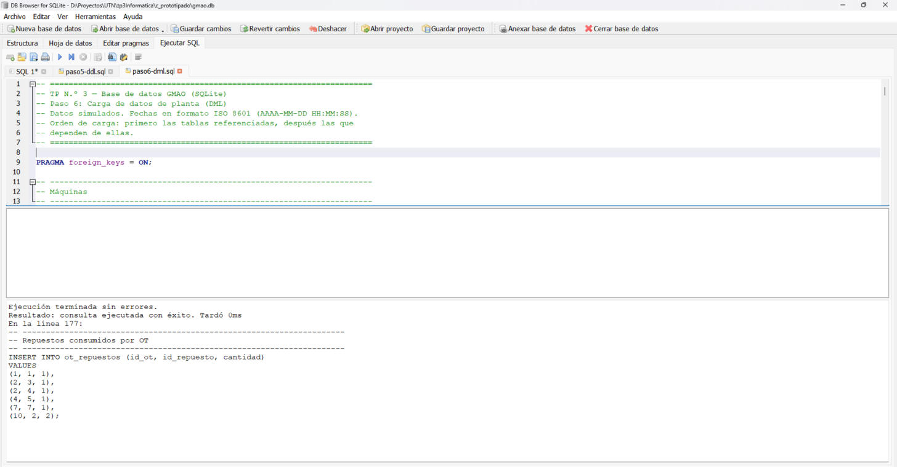
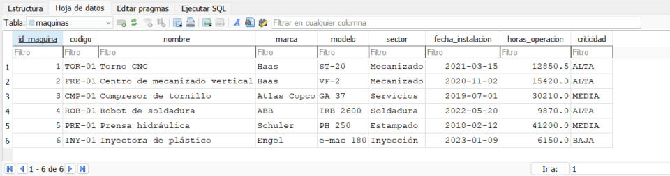

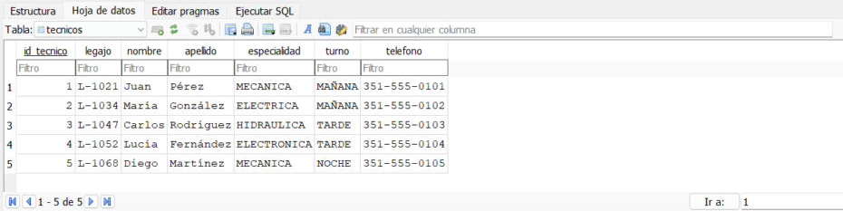

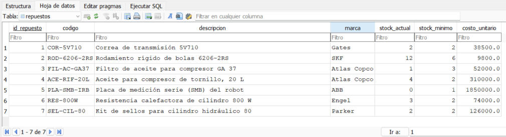

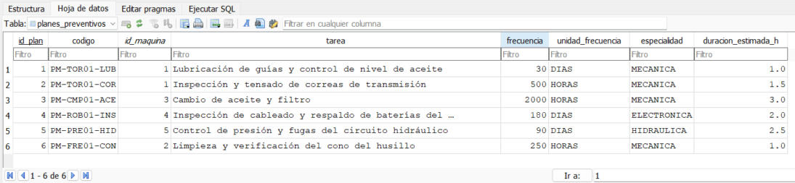

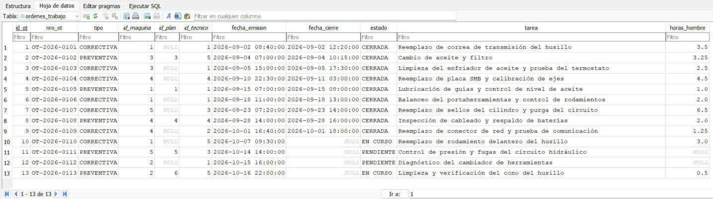

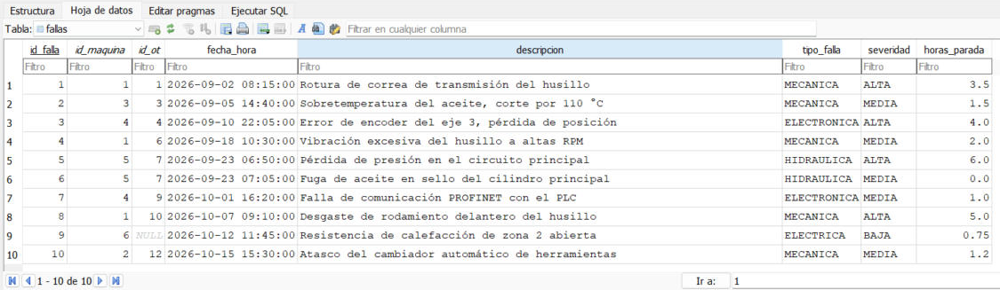

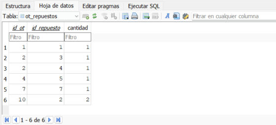

### Activación de claves foráneas

```sql
-- =====================================================================
-- TP N.º 3 — Base de datos GMAO (SQLite)
-- Paso 6: Carga de datos de planta (DML)
-- Datos simulados. Fechas en formato ISO 8601 (AAAA-MM-DD HH:MM:SS).
-- Orden de carga: primero las tablas referenciadas, después las que
-- dependen de ellas.
-- =====================================================================

PRAGMA foreign_keys = ON;
```

### Carga de `maquinas`

```sql
-- ---------------------------------------------------------------------
-- Máquinas
-- ---------------------------------------------------------------------
INSERT INTO maquinas (id_maquina, codigo, nombre, marca, modelo, sector,
                      fecha_instalacion, horas_operacion, criticidad)
VALUES
(1, 'TOR-01', 'Torno CNC', 'Haas', 'ST-20',
    'Mecanizado', '2021-03-15', 12850.5, 'ALTA'),
(2, 'FRE-01', 'Centro de mecanizado vertical', 'Haas', 'VF-2',
    'Mecanizado', '2020-11-02', 15420.0, 'ALTA'),
(3, 'CMP-01', 'Compresor de tornillo', 'Atlas Copco', 'GA 37',
    'Servicios', '2019-07-01', 30210.0, 'MEDIA'),
(4, 'ROB-01', 'Robot de soldadura', 'ABB', 'IRB 2600',
    'Soldadura', '2022-05-20', 9870.0, 'ALTA'),
(5, 'PRE-01', 'Prensa hidráulica', 'Schuler', 'PH 250',
    'Estampado', '2018-02-12', 41200.0, 'MEDIA'),
(6, 'INY-01', 'Inyectora de plástico', 'Engel', 'e-mac 180',
    'Inyección', '2023-01-09', 6150.0, 'BAJA');
```

### Carga de `tecnicos`

```sql
-- ---------------------------------------------------------------------
-- Técnicos
-- ---------------------------------------------------------------------
INSERT INTO tecnicos (id_tecnico, legajo, nombre, apellido, especialidad,
                      turno, telefono)
VALUES
(1, 'L-1021', 'Juan',   'Pérez',     'MECANICA',    'MAÑANA', '351-555-0101'),
(2, 'L-1034', 'María',  'González',  'ELECTRICA',   'MAÑANA', '351-555-0102'),
(3, 'L-1047', 'Carlos', 'Rodríguez', 'HIDRAULICA',  'TARDE',  '351-555-0103'),
(4, 'L-1052', 'Lucía',  'Fernández', 'ELECTRONICA', 'TARDE',  '351-555-0104'),
(5, 'L-1068', 'Diego',  'Martínez',  'MECANICA',    'NOCHE',  '351-555-0105');
```

### Carga de `repuestos`

```sql
-- ---------------------------------------------------------------------
-- Repuestos (stock actual y punto de reposición)
-- ---------------------------------------------------------------------
INSERT INTO repuestos (id_repuesto, codigo, descripcion, marca,
                       stock_actual, stock_minimo, costo_unitario)
VALUES
(1, 'COR-5V710', 'Correa de transmisión 5V710', 'Gates',
    2, 2, 38500.0),
(2, 'ROD-6206-2RS', 'Rodamiento rígido de bolas 6206-2RS', 'SKF',
    12, 6, 9800.0),
(3, 'FIL-AC-GA37', 'Filtro de aceite para compresor GA 37', 'Atlas Copco',
    1, 3, 52000.0),
(4, 'ACE-RIF-20L', 'Aceite para compresor de tornillo, 20 L', 'Atlas Copco',
    4, 2, 310000.0),
(5, 'PLA-SMB-IRB', 'Placa de medición serie (SMB) del robot', 'ABB',
    0, 1, 1850000.0),
(6, 'RES-800W', 'Resistencia calefactora de cilindro 800 W', 'Engel',
    3, 2, 74000.0),
(7, 'SEL-CIL-80', 'Kit de sellos para cilindro hidráulico 80', 'Parker',
    2, 2, 126000.0);
```

### Carga de `planes_preventivos`

```sql
-- ---------------------------------------------------------------------
-- Planes preventivos (por calendario: DIAS; por horómetro: HORAS)
-- ---------------------------------------------------------------------
INSERT INTO planes_preventivos (id_plan, codigo, id_maquina, tarea,
                                frecuencia, unidad_frecuencia,
                                especialidad, duracion_estimada_h)
VALUES
(1, 'PM-TOR01-LUB', 1,
    'Lubricación de guías y control de nivel de aceite',
    30, 'DIAS', 'MECANICA', 1.0),
(2, 'PM-TOR01-COR', 1,
    'Inspección y tensado de correas de transmisión',
    500, 'HORAS', 'MECANICA', 1.5),
(3, 'PM-CMP01-ACE', 3,
    'Cambio de aceite y filtro',
    2000, 'HORAS', 'MECANICA', 3.0),
(4, 'PM-ROB01-INS', 4,
    'Inspección de cableado y respaldo de baterías del controlador',
    180, 'DIAS', 'ELECTRONICA', 2.0),
(5, 'PM-PRE01-HID', 5,
    'Control de presión y fugas del circuito hidráulico',
    90, 'DIAS', 'HIDRAULICA', 2.5),
(6, 'PM-FRE01-CON', 2,
    'Limpieza y verificación del cono del husillo',
    250, 'HORAS', 'MECANICA', 1.0);
```

### Carga de `ordenes_trabajo`

```sql
-- ---------------------------------------------------------------------
-- Órdenes de trabajo
-- Las correctivas no tienen plan (id_plan NULL); las preventivas sí.
-- Las abiertas no tienen fecha de cierre.
-- ---------------------------------------------------------------------
INSERT INTO ordenes_trabajo (id_ot, nro_ot, tipo, id_maquina, id_plan,
                             id_tecnico, fecha_emision, fecha_cierre,
                             estado, tarea, horas_hombre)
VALUES
(1, 'OT-2026-0101', 'CORRECTIVA', 1, NULL, 1,
    '2026-09-02 08:40:00', '2026-09-02 12:20:00', 'CERRADA',
    'Reemplazo de correa de transmisión del husillo', 3.5),
(2, 'OT-2026-0102', 'PREVENTIVA', 3, 3, 5,
    '2026-09-04 07:00:00', '2026-09-04 10:15:00', 'CERRADA',
    'Cambio de aceite y filtro', 3.25),
(3, 'OT-2026-0103', 'CORRECTIVA', 3, NULL, 1,
    '2026-09-05 15:00:00', '2026-09-05 17:30:00', 'CERRADA',
    'Limpieza del enfriador de aceite y prueba del termostato', 2.5),
(4, 'OT-2026-0104', 'CORRECTIVA', 4, NULL, 4,
    '2026-09-10 22:30:00', '2026-09-11 03:00:00', 'CERRADA',
    'Reemplazo de placa SMB y calibración de ejes', 4.5),
(5, 'OT-2026-0105', 'PREVENTIVA', 1, 1, 1,
    '2026-09-15 07:00:00', '2026-09-15 08:00:00', 'CERRADA',
    'Lubricación de guías y control de nivel de aceite', 1.0),
(6, 'OT-2026-0106', 'CORRECTIVA', 1, NULL, 1,
    '2026-09-18 11:00:00', '2026-09-18 13:00:00', 'CERRADA',
    'Balanceo del portaherramientas y control de rodamientos', 2.0),
(7, 'OT-2026-0107', 'CORRECTIVA', 5, NULL, 3,
    '2026-09-23 07:20:00', '2026-09-23 14:00:00', 'CERRADA',
    'Reemplazo de sellos del cilindro y purga del circuito', 6.5),
(8, 'OT-2026-0108', 'PREVENTIVA', 4, 4, 4,
    '2026-09-28 14:00:00', '2026-09-28 16:00:00', 'CERRADA',
    'Inspección de cableado y respaldo de baterías', 2.0),
(9, 'OT-2026-0109', 'CORRECTIVA', 4, NULL, 2,
    '2026-10-01 16:40:00', '2026-10-01 18:00:00', 'CERRADA',
    'Reemplazo de conector de red y prueba de comunicación', 1.25),
(10, 'OT-2026-0110', 'CORRECTIVA', 1, NULL, 5,
    '2026-10-07 09:30:00', NULL, 'EN CURSO',
    'Reemplazo de rodamiento delantero del husillo', 3.0),
(11, 'OT-2026-0111', 'PREVENTIVA', 5, 5, 3,
    '2026-10-14 14:00:00', NULL, 'PENDIENTE',
    'Control de presión y fugas del circuito hidráulico', NULL),
(12, 'OT-2026-0112', 'CORRECTIVA', 2, NULL, 1,
    '2026-10-15 16:00:00', NULL, 'PENDIENTE',
    'Diagnóstico del cambiador de herramientas', NULL),
(13, 'OT-2026-0113', 'PREVENTIVA', 2, 6, 5,
    '2026-10-16 22:00:00', NULL, 'EN CURSO',
    'Limpieza y verificación del cono del husillo', 0.5);
```

### Carga de `fallas`

```sql
-- ---------------------------------------------------------------------
-- Fallas
-- Las fallas 5 y 6 se atienden en la misma OT (7).
-- La falla 9 todavía no tiene OT: está pendiente (id_ot NULL).
-- ---------------------------------------------------------------------
INSERT INTO fallas (id_falla, id_maquina, id_ot, fecha_hora, descripcion,
                    tipo_falla, severidad, horas_parada)
VALUES
(1, 1, 1, '2026-09-02 08:15:00',
    'Rotura de correa de transmisión del husillo',
    'MECANICA', 'ALTA', 3.5),
(2, 3, 3, '2026-09-05 14:40:00',
    'Sobretemperatura del aceite, corte por 110 °C',
    'MECANICA', 'MEDIA', 1.5),
(3, 4, 4, '2026-09-10 22:05:00',
    'Error de encoder del eje 3, pérdida de posición',
    'ELECTRONICA', 'ALTA', 4.0),
(4, 1, 6, '2026-09-18 10:30:00',
    'Vibración excesiva del husillo a altas RPM',
    'MECANICA', 'MEDIA', 2.0),
(5, 5, 7, '2026-09-23 06:50:00',
    'Pérdida de presión en el circuito principal',
    'HIDRAULICA', 'ALTA', 6.0),
(6, 5, 7, '2026-09-23 07:05:00',
    'Fuga de aceite en sello del cilindro principal',
    'HIDRAULICA', 'MEDIA', 0.0),
(7, 4, 9, '2026-10-01 16:20:00',
    'Falla de comunicación PROFINET con el PLC',
    'ELECTRONICA', 'MEDIA', 1.0),
(8, 1, 10, '2026-10-07 09:10:00',
    'Desgaste de rodamiento delantero del husillo',
    'MECANICA', 'ALTA', 5.0),
(9, 6, NULL, '2026-10-12 11:45:00',
    'Resistencia de calefacción de zona 2 abierta',
    'ELECTRICA', 'BAJA', 0.75),
(10, 2, 12, '2026-10-15 15:30:00',
    'Atasco del cambiador automático de herramientas',
    'MECANICA', 'MEDIA', 1.2);
```

### Carga de `ot_repuestos`

```sql
-- ---------------------------------------------------------------------
-- Repuestos consumidos por OT
-- ---------------------------------------------------------------------
INSERT INTO ot_repuestos (id_ot, id_repuesto, cantidad)
VALUES
(1, 1, 1),
(2, 3, 1),
(2, 4, 1),
(4, 5, 1),
(7, 7, 1),
(10, 2, 2);
```

### Verificación de la integridad

Para comprobar que las restricciones funcionan se intentó cargar datos inválidos. Estas sentencias **no forman parte del script**: se ejecutaron aparte y la base las rechazó con el mensaje indicado.

| Intento | Mensaje de SQLite |
|---|---|
| OT preventiva sin plan | `CHECK constraint failed` |
| OT preventiva de otra máquina que su plan | `La OT preventiva debe ser de la misma maquina que su plan` |
| Falla asignada a una OT preventiva | `La falla solo se asigna a una OT correctiva de la misma maquina` |
| Falla de una máquina inexistente | `FOREIGN KEY constraint failed` |
| Número de OT repetido | `UNIQUE constraint failed: ordenes_trabajo.nro_ot` |
| Máquina sin nombre | `NOT NULL constraint failed: maquinas.nombre` |
| Borrar una máquina con historial | `FOREIGN KEY constraint failed` |

Por ejemplo, la primera prueba:

```sql
INSERT INTO ordenes_trabajo (id_ot, nro_ot, tipo, id_maquina, id_plan, id_tecnico, fecha_emision, estado, tarea)
VALUES (90, 'OT-2026-0190', 'PREVENTIVA', 1, NULL, 1, '2026-10-20 08:00:00', 'PENDIENTE', 'Prueba');
```

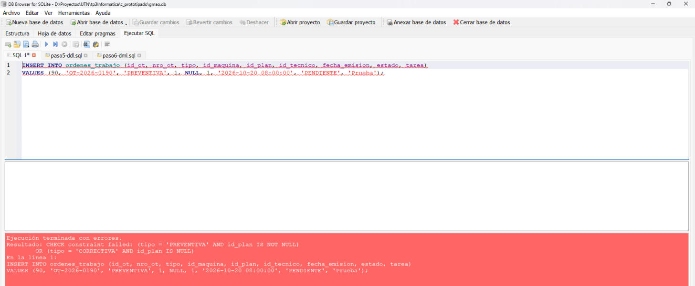
