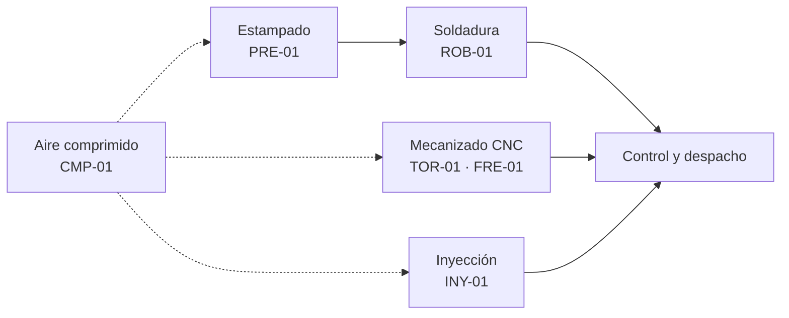

# Introducción

En una planta industrial, cada hora que una máquina está detenida es producción que no se entrega. El área de mantenimiento existe para reducir esas horas: repara lo que falla y, sobre todo, se anticipa a las fallas con tareas preventivas. Para hacerlo bien necesita información confiable. Necesita saber qué máquinas fallan más, cuánto tiempo estuvieron paradas, qué órdenes de trabajo siguen abiertas, quién las atiende y qué repuestos faltan en el pañol. Cuando esa información vive en planillas sueltas o en cuadernos, se pierde, se duplica o se contradice. Un sistema de **gestión de mantenimiento asistido por ordenador (GMAO)** la centraliza, y en su base hay una base de datos relacional.

## Objetivo

El objetivo de este trabajo es investigar, diseñar, implementar y consultar una base de datos relacional orientada al ámbito industrial, usando el lenguaje SQL. De los escenarios propuestos por la cátedra se eligió el de **Gestión de Mantenimiento Industrial (GMAO)**: registro de activos, historial de fallas, órdenes de trabajo correctivas y preventivas, técnicos asignados y repuestos utilizados.

## Caso de estudio

Para que los datos tengan sentido se planteó una empresa: **Autopartes G4 S.A.**, una metalmecánica ficticia de Córdoba que fabrica autopartes para proveedores de la industria automotriz y trabaja en tres turnos. Su proceso productivo combina cuatro líneas y un servicio común:

La prensa hidráulica estampa la chapa, el robot suelda los subconjuntos, el torno CNC y el centro de mecanizado fabrican piezas de precisión y la inyectora produce los componentes plásticos. El compresor abastece de aire comprimido a toda la planta. Esas seis máquinas son los activos que gestiona el sistema. Un equipo de cinco técnicos de distintas especialidades los mantiene, con un pañol de repuestos propio. Las fallas dan lugar a órdenes de trabajo correctivas, y un conjunto de planes preventivos, por calendario o por horas de uso, genera las órdenes preventivas.

El nombre de la empresa, el personal y todos los registros son **simulados**. Las marcas y modelos de las máquinas son reales y se eligieron para que los datos sean verosímiles. El período registrado va de septiembre a octubre de 2026.

## Alcance

El sistema cubre el registro de los activos y su historial de fallas, los planes preventivos, las órdenes de trabajo con su técnico, su estado y sus horas-hombre, y el consumo y el stock de repuestos. Quedan fuera las compras, el costo de la mano de obra, la programación automática del preventivo y la lectura automática de sensores.

## Metodología y organización del informe

El trabajo se desarrolló en forma secuencial, en las cuatro fases que fija el enunciado. Cada paso incluye su justificación teórica, la descripción del procedimiento y capturas de pantalla como evidencia.

- **Fase I — La Investigación (Pasos 1 y 2).** Qué es una base de datos, cómo se clasifican y para qué se usan en la industria. Elección del motor **SQLite** y de la herramienta **DB Browser for SQLite**.
- **Fase II — La Planificación (Pasos 3 y 4).** Las entidades del mantenimiento, sus atributos y tipos de datos, y el modelo relacional con su diagrama entidad-relación. Antes de definir el modelo se relevó cómo resuelven el problema los gestores de mantenimiento de uso industrial.
- **Fase III — La Construcción (Pasos 5 y 6).** Los scripts que crean las tablas con sus restricciones de integridad y los que cargan los datos de planta.
- **Fase IV — La Consulta (Pasos 7, 8 y 9).** Siete consultas que responden preguntas concretas del supervisor, del encargado del pañol y del jefe de mantenimiento: filtrado, estadísticas por agrupación y reportes que cruzan tablas.

El código SQL aparece en el texto en letra monoespaciada y es el mismo que se ejecutó en las capturas. El conjunto completo de sentencias se entrega, además, en el archivo `tp3-gmao.sql`. Las fuentes consultadas se listan en las referencias, al final del informe.
